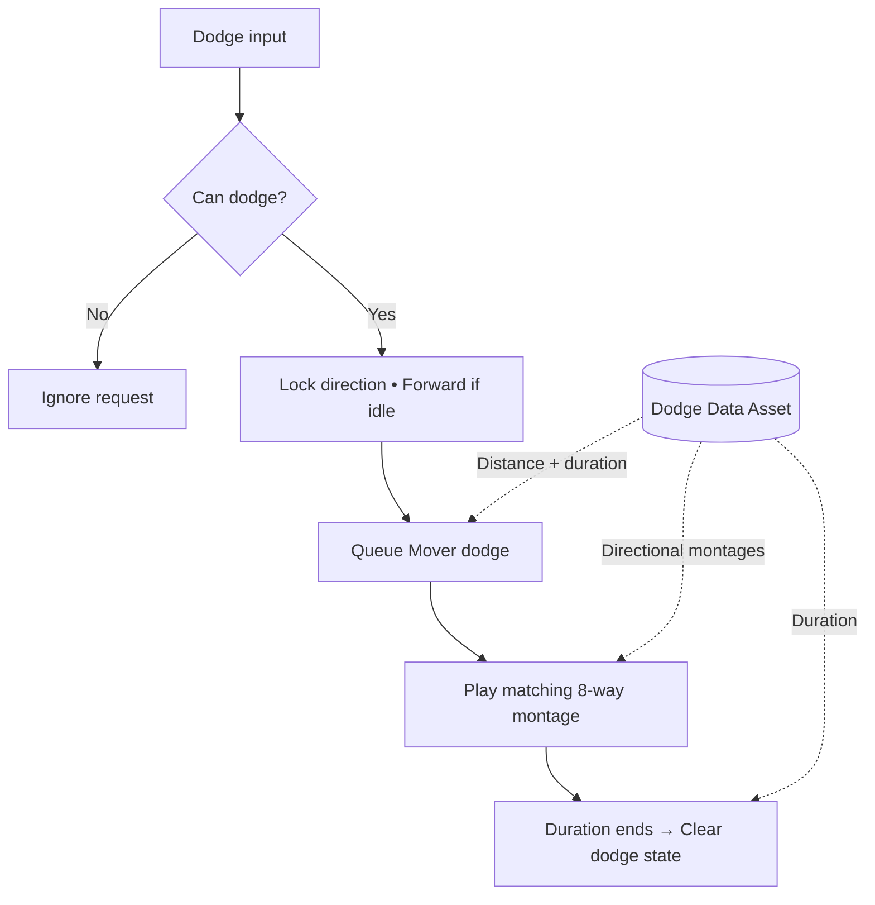

# Dodge Roll System

A compact overview of an 8-way dodge roll system in Unreal Engine using C++ and Mover.

**Can dodge?** checks that the character is grounded, is not already dodging, and has a valid setup.

The configurable Dodge Data Asset supplies dodge distance, duration, and the montage for each of the eight directions.
